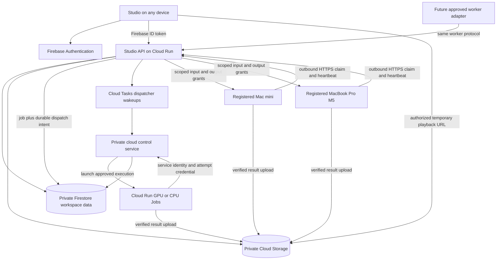

# Accounts, private workspaces, and registered rendering engines

Status: detailed implementation plan; no feature implementation or deployment in this change.

Prepared October 17, 2026 (America/Los_Angeles), against `main` at `3ef1036`.
Official service documentation was checked during planning. Recheck pricing,
quotas, region availability, and dependency versions before provisioning.

Reading guide: [decisions](#1-outcome-and-decisions),
[user experience and registration](#3-user-experience),
[architecture](#4-architecture-and-execution-contract),
[security](#5-authentication-tenancy-and-authorization),
[Mac fleet](#8-registered-mac-fleet-and-future-providers),
[cloud compute](#9-google-cloud-compute-adapter),
[milestones](#14-implementation-milestones-and-file-map), and
[implementation handoff](#16-decisions-before-provisioning-and-implementation-handoff).

## 1. Outcome and decisions

Users should sign in with email and password, save scripts, voice samples,
portraits, and generated media in a private Firebase workspace, and continue
from another device. Rendering must support **registered Mac minis, MacBook Pro
M5 laptops, and future GPU providers**, as well as Google Cloud GPUs. Closing
the submitting browser must not cancel a job.

Firebase supplies authentication, metadata, and object storage. Speech and video
inference run on a registered compute worker. Keeping these responsibilities
separate lets the same studio use an existing Mac or paid cloud capacity.

### Recommended defaults

| Decision | Recommendation |
| --- | --- |
| Identity | Firebase Authentication email/password, verified email, reset flow, SDK-managed sessions |
| Initial access | Invite-only application access; personal workspace created once per approved account |
| Future tenancy | Tenant-scoped data and memberships immediately; organization/team UI later |
| Browser hosting | Firebase Hosting serving a public application shell with no private content embedded |
| Application backend | Node/TypeScript API on Cloud Run; official Firebase Admin SDK and Google Cloud clients |
| Private data | Firestore metadata and Cloud Storage objects, accessible through authorized API operations |
| Rendering default | Next available compatible **registered Mac** in the workspace; allow pinning a particular device |
| Registered devices | Mac mini and MacBook Pro M5 are equal supported worker types; friendly names and capability-based scheduling |
| Cloud GPU | Optional Google Cloud Run GPU Jobs using a Linux/CUDA adapter; explicitly enabled with a budget |
| Fallback | Wait when Macs are unavailable. Never change to paid cloud compute without an approved policy or explicit user action |
| Voice | Kokoro Heart remains the stock default; Qwen personal profiles require consent and an accepted audition |
| Local mode | Existing loopback/offline studio remains usable without an account |
| Initial deployment | Isolated staging project first; do not place private content behind the existing shared demo rules |

The three supported modes are:

1. **Local only:** files and inference stay on the current Mac, with existing local behavior.
2. **Private workspace + registered Mac:** sign in from any device; Firebase holds
   selected workspace content; a paired Mac mini or laptop renders and uploads results.
3. **Private workspace + cloud GPU:** the same workspace and job contract use
   Google Cloud compute; no personal Mac needs to remain online.

Uploading an existing local voice or photo is explicit. Signing in or registering
a worker must not synchronize the Mac's entire local library.

### Release boundaries

The first usable release delivers accounts, private storage, and the registered
Mac fleet. The next milestone adds real cloud Qwen rendering and cloud video
composition. Full cloud realistic portraits have a separate portability/license
gate. All are included below; a Mac-only milestone is not completion of the
cloud-compute objective.

Out of scope for the first release: public voice catalogs, selling subscriptions,
automatic social publishing, enterprise SSO, cross-organization voice sharing,
and arbitrary user-supplied worker containers or execution scripts.

## 2. Existing implementation and necessary changes

These findings describe checked-in source, not an audit of the currently deployed
Firebase project's rules, billing, users, IAM, or data.

| Area | Existing implementation | Required change |
| --- | --- | --- |
| Browser identity | `src/firebase/client-bridge.ts` creates anonymous accounts and caches their ID token | Explicit sign-in and SDK token refresh; no anonymous fallback in private mode |
| Shared data | Global `episodes`, `productions`, `avatars`, `auditions`, and `workflow` collections | Workspace-scoped IDs, ownership, membership checks, and isolated queries |
| Firestore access | `firestore.rules` permits public reads and unauthenticated creates/updates for several operational collections, including productions | Private environment defaults to deny browser database access; API validates all operations |
| Storage access | `storage.rules` allows public media reads and broad authenticated writes; its catch-all also grants authenticated writes | Private buckets and explicit application authorization; no permissive legacy catch-all |
| Roles | Editor helper includes a verified `@sap.com` domain rule | No domain-based automatic membership or administration |
| Hosting export | `src/firebase/export-studio.ts` copies a prepared library, API snapshots, and avatars into Hosting output | New app-shell build; no private script, photo, sample, or result in static deploy assets |
| Worker | `src/firebase/worker.ts` polls shared jobs and synchronizes local/cloud avatars and presentations | Registered workers with capability discovery, tenant-bound leases, and isolated job directories |
| Credentials | `src/firebase/rest-client.ts` can use CLI credentials, user ADC, or anonymous auth | Cloud workload service identities; Macs use scoped paired-device credentials |
| Media URLs | Storage adapter persists download URLs, including tokens when returned | Persist asset references; issue short-lived access only after authorization |
| Personal voices | `src/media/voice-reference.ts` and `cloud-voice-safety.ts` deliberately reject local personal voices in cloud paths | Add a distinct workspace voice type; retain all local-only protections |
| Qwen runtime | `src/media/qwen-runner.py` uses MLX/Metal and requires Apple Silicon | Reuse on registered Macs; separate pinned PyTorch/CUDA implementation for cloud GPUs |
| Production | `src/production.ts` reads project files and local media state | Inject input snapshot, storage, runtime, and execution context; preserve local adapter |
| Timing | `src/generation-timing.ts` tracks preparation, narration, and render time | Extend with queue/transfer/startup timing and worker identity without inventing old measurements |

Adding a login screen alone does not protect exported static files, shared job
collections, or tokenized download URLs. Private hosting and authorization are
prerequisites to accepting personal samples remotely.

The older [Firebase architecture](FIREBASE_ARCHITECTURE.md) and
[hybrid guide](FIREBASE_HYBRID_STUDIO.md) describe the shared mode. This plan
supersedes their public-access architecture for the new private product.

## 3. User experience

### Account and workspace

- Sign up, sign in, verify email, resend verification, reset password, and sign out.
- An approved, verified account gets one personal workspace through an idempotent
  server operation. Unapproved users see an access-pending page, not another user's content.
- Display the active workspace and account consistently. A future workspace
  switcher uses the same membership model without changing asset identities.
- Default to session persistence, with an explicit “Remember me on this device”
  choice. Clear private application caches, object URLs, and pending subscriptions
  on sign-out or workspace switch.
- The same account on a second machine sees saved drafts, selected voice revisions,
  registered engines, production history, and completed media.
- Saves use revision preconditions. Two browsers editing the same draft receive
  a clear conflict/reload-or-save-new-version flow rather than overwriting silently.

### Rendering engines page

Show a table/cards for **Mac mini**, **MacBook Pro M5**, and configured cloud
providers. User-friendly names are editable; internal IDs remain stable.

| Field/control | Behavior |
| --- | --- |
| Status | Online and available, busy, draining, offline, setup required, update required, disabled, revoked |
| Last seen | Server receipt time and readable elapsed time; no inaccurate online claim after a stale heartbeat |
| Capabilities | Kokoro, Qwen voice cloning, alignment, lightweight portraits, realistic Ditto, video composition; exact supported runtime revisions |
| Capacity | Active jobs / allowed slots; each Mac starts with one shared heavy-inference slot |
| Activity | Current job link and stage, visible only to authorized members; no raw sample paths or transcript snippets |
| Queue | Eligible waiting jobs and approximate wait when measured evidence exists |
| Cost | “Uses your Mac” or cloud compute estimate; Mac mode can still incur Firebase storage/network charges |
| Actions | Register device, rename, pause new jobs, resume, run diagnostic job, revoke, choose preferred device/pool |

Registration flow:

1. Owner chooses **Add rendering engine → Mac** and installs/starts the worker on
   the intended device using the documented CLI.
2. Worker requests a short-lived pairing session and displays a code and exact
   workspace pairing URL. It generates a high-entropy polling secret separately
   from the human-readable code.
3. Owner signs in, verifies the code and device details, and approves that device
   for the selected workspace. Pairing expires after ten minutes, is single use,
   and is rate limited. The pairing code alone cannot retrieve credentials.
4. Worker receives its scoped device credential, stores it in macOS Keychain,
   reports capabilities, and completes a small synthetic diagnostic.
5. Studio shows the device as available only when the diagnostic and required
   runtime checks pass. Installing missing models remains a device-owner action.

Suggested CLI surface, to implement rather than run now:

```text
shorts worker-register --server <approved-studio-origin> --name "Mac mini"
shorts worker-register --server <approved-studio-origin> --name "MacBook Pro M5"
shorts worker-start
shorts worker-status
shorts worker-pause
shorts worker-resume
shorts worker-unregister
```

Allow an opt-in LaunchAgent for the Mac mini. A laptop can start/stop the worker
manually and optionally stop accepting jobs on battery. Do not disable sleep
permanently or change power settings silently. A laptop that sleeps becomes
offline; the job recovery protocol handles this explicitly.

### Voice, portrait, and production

- Keep voice selection and avatar/photo controls together and visible. Adding
  cloud voices must not remove either presenter's portrait controls in dialogue.
- Label profiles as **On this Mac** or **Private workspace**. Show selected
  speaker/profile, revision, and compatible rendering engines before production.
- Workspace enrollment records or uploads a sample, verifies its transcript and
  trim, obtains consent for storage and the selected processing destinations,
  generates an audition, and requires listening/acceptance.
- Offer **Next available Mac**, **Specific registered device**, and **Cloud GPU**
  only when configured. Filter by the complete job's capabilities, including the
  voice approval and portrait engine. Explain why a device is incompatible.
- In Mac-pool mode, use the next compatible available device; a busy/offline Mac
  does not block another eligible Mac. In pinned mode, wait for that exact device.
- If every eligible Mac is offline, show “Waiting for a registered Mac,” with
  last-seen information, cancel, and an explicit change-engine action.
- Closing the page does not stop work. Active jobs appear at the top of the
  workspace; history is newest submission first, with completion time and filters.
- Results show voice used, engine/device, actual audio/video/total generation
  time, queue wait, and whether audio or video was reused.

## 4. Architecture and execution contract



**Firestore is the authoritative job queue and state store.** Cloud Tasks is a
durable wakeup/dispatch mechanism for cloud execution, not a second source of
job truth. Registered Macs poll the API for leases. Both use the same scheduler,
state machine, attempt fencing, authorization checks, and result contract.

Use an explicit `local` or `workspace` application transport. Retire global
`fetch`/`EventSource` monkey-patching in private mode. A failed local health check
must not switch an offline local studio to cloud mode and upload content.

Use Firebase's modular Auth SDK in a bundled browser entry point. Use a small
typed API client for all private data. The first version can poll active jobs
every 3–5 seconds, back off when idle, and stop on sign-out; realtime database
subscriptions can be added after authorization and cost behavior are tested.

### Provider and worker abstractions

Separate a **provider** (registered Mac fleet, Google Cloud Run, future approved
backend), a **worker** (one physical device or cloud execution), and an **engine**
(Qwen MLX, Qwen CUDA, Kokoro, Ditto, FFmpeg). A GPU/chip name alone is insufficient
to prove an episode is renderable.

Suggested contracts:

```text
WorkerDescriptor:
  workerId, providerId, tenantId, displayName, platform, architecture,
  acceleration, protocolVersion, appVersion, runtimeDigests,
  capabilities, maxSlots, status, lastSeenAt, registeredBy

ExecutionTarget:
  mode: mac-pool | device | cloud
  providerId, workerId?, requiredCapabilities, runtimePolicyId

RenderAdapter:
  probeCapabilities(), prepareInput(snapshot), run(stage, progress, cancel),
  verifyOutputs(), collectMetrics(), cleanup()

WorkerProtocol:
  heartbeat(), claimCompatibleJob(), renewLease(), getInputManifest(),
  reportProgress(), requestUploadGrant(), completeAttempt(), failAttempt()
```

Register new providers through server-controlled adapter configuration, not a
browser-supplied shell command, image, URL, or arbitrary model repository. New
providers must pass the same protocol conformance suite. Platform-managed cloud
capacity is displayed as enabled/available/limited; an idle cloud provider is not
incorrectly described as an offline physical device.

## 5. Authentication, tenancy, and authorization

### Accounts

Enable email/password through Firebase Authentication. Use SDK flows for account
creation, verification, password reset, password changes, and session persistence;
the application never stores or hashes account passwords. Configure a password
policy and email enumeration protection; errors must avoid revealing whether an
email is registered. Firebase documents these capabilities in its
[password authentication guide](https://firebase.google.com/docs/auth/web/password-auth).

The API verifies ID token signature, issuer, audience, expiry, verified email,
account status, and revocation using the Admin SDK. Resolve the UID from the
verified token. Sensitive actions also require recent authentication. Membership
and suspension are checked from current server data on each authorized operation,
not trusted solely from stale token claims. See
[ID token verification](https://firebase.google.com/docs/auth/admin/verify-id-tokens)
and [session revocation](https://firebase.google.com/docs/auth/admin/manage-sessions).

An invitation is an application access gate. Hiding the sign-up button does not
prevent Firebase account creation through its public endpoint. Even an account
created outside the UI gets no workspace, storage grant, worker pairing, or job
without verified invitation redemption. Bind redemption to the verified email
and UID, with expiry and a transaction. Add stronger identity-provider signup
restrictions later if required; do not claim UI gating enforces them.

### Workspaces from day one

Use opaque `tenantId` workspace IDs, independent of emails, episode selectors,
and device names. Bootstrap a personal workspace transactionally and store its
ID in the user's server-owned profile. Existing accounts must never claim legacy
shared content merely by matching an email domain.

| Role | Allowed operations |
| --- | --- |
| Owner | Workspace settings, budgets, membership/ownership, worker pairing/revocation, content and deletion |
| Admin | Content and worker administration; no ownership transfer or workspace deletion |
| Editor | Drafts, approved assets, production/cancel, review; subject to voice-specific grants and budget limits |
| Viewer | Read permitted drafts/results and download allowed output; no generation or raw voice sample access |

A personal workspace initially has its owner only. Model the other roles now and
test them; defer general organization invites and role-management UI. Raw voice
samples, transcripts, and reusable conditioning data are restricted to the voice
owner and narrowly authorized worker attempts. Workspace admins can revoke/delete
a voice but do not automatically gain permission to download or impersonate it.
Future use grants are explicit per profile; workspace membership alone is not a
grant to use every member's voice.

Application workspaces do not require a separate Identity Platform identity
tenant for each user. Reserve that feature for customers requiring separate user
directories, identity providers, or enterprise sign-in policy. Google's
[identity multitenancy](https://docs.cloud.google.com/identity-platform/docs/multi-tenancy)
isolates identities/configuration; it does not replace application data authorization.

### Access enforcement

- All private Firestore and Storage browser rules deny access in the new
  environment; browser data operations go through the API. Public tutorial
  templates are separately approved build assets, never a wildcard exception.
- API repository methods require a validated `TenantContext`. Never accept
  client-supplied `createdBy`, roles, asset URLs, storage prefixes, job states,
  model commands, or worker assignment as authority.
- Verify referenced draft, asset, voice revision, worker, and job belong to the
  same workspace and are permitted for this actor. Deny cross-tenant ID probes
  without revealing another workspace's metadata.
- Admin/server clients bypass Firebase security rules. Therefore API and worker
  authorization tests are as important as rules tests; see
  [Firestore server access](https://firebase.google.com/docs/firestore/security/rules-conditions).
- App Check can add browser abuse protection after staging validation; it is
  supplementary to account, membership, quota, and device checks. Paired workers
  use a separate authenticated protocol, not browser App Check debug tokens.
- Use TLS, restricted CORS, a reviewed CSP, safe rendering of user text, and no
  tokens or samples in logs. Browser bearer tokens stay out of URLs; SDK session
  persistence replaces hand-written token storage.

## 6. Firestore and Storage schema

Proposed paths; finalize types and validation before any migration:

```text
users/{uid}                             # own profile, personal workspace ID
users/{uid}/workspaceRefs/{tenantId}     # server-maintained discovery index only
accessInvitations/{invitationId}        # server-only redemption state
tenants/{tenantId}
  members/{uid}
  episodes/{episodeId}
    revisions/{revisionId}              # immutable source/script snapshot
  assets/{assetId}                      # type, object generation, hash, owner
  voiceProfiles/{profileId}
    revisions/{revisionId}              # sample + transcript/trim digests
    auditions/{auditionId}
    approvals/{approvalId}              # exact audition/runtime acceptance
  jobs/{jobId}
    attempts/{attemptId}
    events/{eventId}                    # bounded, redacted progress history
  workers/{workerId}
  providers/{providerId}
  usage/{periodId}
  reservations/{reservationId}
  auditEvents/{eventId}
  deletionRequests/{requestId}
dispatchOutbox/{dispatchId}             # service-only, carries tenantId/jobId
workerCredentials/{credentialId}        # hashes/rotation/revocation; service-only
```

Workspace references aid navigation; only `tenants/.../members` grants access.
Do not store samples, base64 portraits, large logs, or model weights in Firestore.
Index tenant-local jobs by state/createdAt, updatedAt, and assigned worker as
needed. Exempt transcript/body/large metadata fields from unnecessary indexing.
Use pagination and deterministic timestamp-plus-ID cursors. Administrative
collection-group queries are never exposed as unscoped browser search.

```text
private bucket:
  tenants/{tenantId}/quarantine/{uploadId}/source
  tenants/{tenantId}/voices/{profileId}/{revisionId}/reference.wav
  tenants/{tenantId}/voices/{profileId}/{revisionId}/conditioning/{runtimeDigest}/...
  tenants/{tenantId}/auditions/{auditionId}/audio.wav
  tenants/{tenantId}/portraits/{assetId}/{revisionId}/portrait.png
  tenants/{tenantId}/jobs/{jobId}/attempts/{attemptId}/...
  tenants/{tenantId}/outputs/{outputId}/short.mp4
  tenants/{tenantId}/outputs/{outputId}/narration.wav
  tenants/{tenantId}/outputs/{outputId}/captions.vtt
  tenants/{tenantId}/outputs/{outputId}/manifest.json
  tenants/{tenantId}/outputs/{outputId}/package.zip

separate model bucket/image layers:
  models/{engine}/{immutableRevision}/...  # no customer content
```

An asset records its server-created object path, object generation, SHA-256, byte
size, MIME type, lifecycle state, tenant, owner, and provenance. Save references,
not permanent bearer download URLs. Final objects are immutable; only a verified
manifest is published to the application after every required file exists.

New presentation schema adds a discriminated workspace voice reference, for example:

```json
{
  "kind": "workspace-voice",
  "tenantId": "workspace-id",
  "profileId": "profile-id",
  "revision": "immutable-revision"
}
```

Keep existing stock strings and `{engine: "qwen", profileId, revision}` local
references readable with their current semantics. Resolve runtime approvals on
the server and freeze them into the job snapshot. A workspace ID in JSON is a
reference to validate, not proof of access. Local exports still reject private
workspace assets unless the user explicitly downloads an authorized package.

## 7. Samples, portraits, and private media delivery

### Upload and enrollment

1. API checks membership, voice ownership, quota, and consent before allocating
   an upload. For initial small samples/photos, stream through an authenticated
   API upload endpoint with a strict byte limit and deadline into quarantine.
2. Reuse current constraints initially: sample upload maximum 30 MiB, decoded
   source at most 120 seconds, selected range 3–30 seconds (10–15 recommended),
   bounded transcript. For portraits preserve current documented 4 MB input limit.
3. Check real media decoding, duration/dimensions, MIME signature, finite audio,
   silence/clipping, and safe image normalization in an isolated CPU process.
   Client MIME/type/extension checks alone are insufficient. Strip photo metadata.
4. Normalize to the pipeline's documented WAV/PNG formats, hash final bytes, and
   create an immutable revision. Never deserialize uploaded Python pickle/model
   prompt objects. Derive conditioning internally from approved audio/text.
5. Generate the audition through the selected registered engine. Record sample,
   transcript, text normalization, model, runtime/configuration, and audition hashes.
6. Acceptance records actor, time, consent revision, exact audition, profile
   revision, and runtime compatibility key. New samples or changed voice-producing
   runtime require a new audition. No silent fallback to Heart or another profile.

Cloud storage consent must explain whether processing is allowed on the user's
paired Macs, platform cloud compute, or both. A newly registered device is not
automatically granted access to every sensitive profile: require owner approval
or an explicitly selected trusted-device-pool policy. Transfer to a new workspace
requires new authorization. Local enrollment consent is not cloud-upload consent.

### Runtime acceptance across devices

Two Macs can share acceptance when their approved voice model, normalization,
package/runtime manifest, inference settings, and engine compatibility key match.
The physical machine ID need not force another audition. A hardware-only change
should trigger a diagnostic and documented compatibility check; numerical
variation is possible. MLX and CUDA acceptance remain distinct unless a later,
documented equivalence policy is deliberately approved.

Define a portable compatibility digest from model file hashes, relevant package
versions, normalization/inference code, and settings. Exclude hostnames, absolute
installation paths, file modification times, and unrelated packages. Existing
local runtime/cache hashes may contain machine-specific details; do not reuse
them blindly as cross-device compatibility IDs or weaken their local checks.

### Playback and download

- Serve small private reference audio through authenticated API fetch to a
  temporary browser blob; restrict it to the profile owner. Revoke blobs on exit.
- For completed videos/packages, the API can issue a five-minute read-only signed
  URL for a specific object generation after authorization. Refresh on expiry
  while preserving playback position; support byte ranges and download names.
- Signed URLs are bearer capabilities during their lifetime; membership revocation
  prevents new URLs but cannot invalidate an already issued URL instantly. No
  public caching, no URL logging, and no tokenized permanent Firebase URLs.
  Immediate revocation requirements would require an authenticated media proxy.
  See [Cloud Storage signed URLs](https://docs.cloud.google.com/storage/docs/access-control/signed-urls).
- Use server-authorized upload grants for large worker outputs, bound to an attempt
  path and expected artifact. Verify actual size, digest, generation, and manifest
  before accepting; a signed upload URL alone is not complete validation.
- Set bucket public-access prevention and appropriate private IAM. Deny rules do
  not constrain server IAM or signed URL grants; those require their own checks.

## 8. Registered Mac fleet and future providers

### Trust and credentials

Macs connect outbound over HTTPS; do not expose a laptop's localhost studio or
require port forwarding. The paired credential is a random, revocable device
secret stored in Keychain, with a hash and binding stored server-side. Give it
only heartbeat, claim, and assigned-attempt operations for one workspace in v1.
Rotate with bounded overlap and explicit expiry; revoke on removal or owner
request. Device credentials cannot sign in as a user, administer members, browse
all voice profiles, edit scripts, or list the bucket.

Use separate middleware for worker credentials and user ID tokens. Every worker
operation checks credential status, workspace, assignment, and live lease.
Short-lived input/output grants contain only frozen job assets. A copied or
revoked credential cannot claim another workspace's jobs.

A paired Mac is trusted to handle the inputs assigned to it; it can technically
observe those bytes. Communicate this at registration and profile permission
selection. Workspace isolation does not protect data from a malicious operator
of an explicitly trusted rendering device.

### Availability and capabilities

- Heartbeat every 20 seconds; mark availability stale after 90 seconds, offline
  after two minutes. Use server timestamps. These are initial configurable values.
- Heartbeats report configured slots, active attempt, protocol/app versions,
  available model/runtime digests, and supported tasks. Redact filesystem paths,
  environment variables, and unrelated device/process information.
- Device revocation and maintenance/disabled status override heartbeats. A worker
  cannot re-enable itself by advertising “available.” Reject unsupported protocols.
- One heavy job per Mac, sharing the existing inference lock with local studio
  use. A local render occupies that slot too; “online” must not mean “free.”
- Match on capabilities and consent, not chip branding. M5 and Mac mini workers
  can have different models installed. No eligible device means an actionable
  setup/wait state, not a failing render loop.
- Owner can drain a worker: finish current work, accept no new jobs. Revoke stops
  future grants immediately and requests cancellation of active work.

### Job isolation and recovery

Run in a dedicated worker data directory, not the developer's Git checkout.
Each attempt gets its own tenant/job/attempt directory, private files, media DB,
logs, and cleanup policy. Share only immutable model weights between jobs.
Do not synchronize all `assets/avatars`, drafts, or `.state/voice-profiles`.

The worker fetches only assigned assets, verifies hashes, and launches an isolated
subprocess. Inference stays offline after staging inputs. Qwen/Kokoro/Ditto run
sequentially on that Mac, while another registered Mac can process another job.
Model installation and updates are explicit and keep known-working versions.

On sleep/disconnect, the controller marks the attempt suspect. Stop/kill the local
child if lease renewal cannot be maintained within the configured safety window.
On wake, reconcile the lease before resuming or uploading. The scheduler may move
a job to another compatible authorized Mac only after fencing the old attempt.
An old process might still consume compute during a network partition; only the
current attempt can publish results or settle usage.

Workspace jobs use workspace voice adapters and scoped staged references. Never
reinterpret an existing `localOnly` profile as remotely accessible. Optional
future multi-workspace workers need separate explicit grants and caches per
workspace; v1 pairs each worker to one workspace to keep the trust boundary clear.

## 9. Google Cloud compute adapter

### Recommended implementation

Use Cloud Run **Jobs** for bounded background inference, not a browser request
held open during generation. The GPU Jobs documentation currently lists NVIDIA
L4 with 24 GB VRAM, minimum 4 vCPU/16 GiB system memory, one GPU per instance, and
non-zonal redundancy for jobs. `us-central1` is a candidate region, subject to
residency, availability, and approved quota. See
[GPU Jobs configuration](https://docs.cloud.google.com/run/docs/configuring/jobs/gpu).
GPU tasks currently have a one-hour maximum; choose a shorter application limit
after benchmarks and split longer work at verified stage boundaries. See
[job timeouts](https://docs.cloud.google.com/run/docs/configuring/task-timeout).

Start with one task per execution, one permitted active GPU execution globally,
and one active cloud-GPU generation per workspace. Mac capacity is independent:
allow two concurrent Mac jobs in the initial two-device workspace, with one heavy
job per device and a configurable workspace limit. Cloud Run task parallelism
alone does not cap separate executions; the dispatcher needs a global transactional permit.
Native task retries start disabled so application attempts own retry accounting.

Create distinct adapters:

| Adapter | Work | Initial path |
| --- | --- | --- |
| `qwen-mlx` | Existing Qwen speech and alignment | Paired Apple Silicon worker |
| `qwen-cuda` | Qwen Base cloning and forced alignment | Pinned Linux CUDA GPU image |
| `kokoro` | Stock voices including Heart | Existing Mac adapter; Linux compatibility test for cloud |
| `video-compose` | Scene/caption composition, FFmpeg, validation/package | Mac or isolated CPU Cloud Run Job |
| `ditto-mps` | Existing realistic portraits | Registered Mac |
| `ditto-cuda` | Realistic cloud portraits | Separate benchmark and model-license gate |

Official Qwen supports Base voice cloning through its PyTorch interface;
the current local MLX Python environment cannot simply be copied into a Linux
container. Implement against pinned
[Qwen3-TTS](https://github.com/QwenLM/Qwen3-TTS) and
[Qwen3-ForcedAligner](https://github.com/QwenLM/Qwen3-ASR) releases/model revisions.
Keep sample preprocessing, pronunciation expansion, sentence grouping, output
validation, and caption contracts aligned with the local pipeline. Model
families alone do not guarantee matching voices or performance.

### Benchmark and quality gate

Use a synthetic or explicitly cloud-authorized reference for staging. Measure
cold image/model startup, normalization, generation, alignment, upload, peak
VRAM/RAM, wall time, and cost across a short audition, a 45–60-second single voice
episode, two distinct voices, and mixed stock/personal narration. Measure at least
five cold runs for initial ranges; do not claim reliable p95 before enough samples.

Compare acronym pronunciation, speaker identity, clipping, silence, cadence,
caption timing, and exact selected profile. Forced alignment is not proof that
the model spoke every supplied word. Listen to auditions and require the intended
speaker to accept their personal cloud voice. Use existing integrity checks for
WAV, MP4, frames, duration, captions, and provenance.

Bake or preload checksum-pinned models into immutable artifacts. No per-job
download from arbitrary model URLs, `latest` image tags, private samples in image
layers, or untrusted pickle loading. Unload TTS before alignment if needed for
memory. Keep inference network-disabled separately from the transfer supervisor.

Preserve current portrait motion/lip fixes when porting. Upstream
[Ditto](https://github.com/antgroup/ditto-talkinghead) supplies a GPU implementation,
but our MPS adaptations and auxiliary models still require portability and rights
review. A source repository license does not establish rights for every downloaded
model. Keep realistic Mac rendering available while this gate is unresolved;
cloud jobs requiring unsupported portraits must fail preflight or require the
user to explicitly choose a supported presenter.

### Cloud service identities

Use separate API, dispatcher/control, CPU worker, GPU worker, and deployment
service accounts. Use workload credentials, not checked-in keys or developer CLI
tokens. CI uses workload identity federation. The browser-facing API verifies
Firebase identity at application level; its reachable HTTPS endpoint is not
authorization by itself. The separate cloud control service is IAM-private.

Cloud workers receive a job/attempt binding and short-lived attempt credential;
the private control service verifies both workload identity and assignment. Give
workers no general Firestore access and only scoped input/output capabilities.
The dispatcher can invoke approved job definitions, not deploy arbitrary images.
Signed-URL signing rights are restricted to designated identities/buckets.

## 10. Scheduling, correctness, and timing

### Submission and state machine

```text
QUEUED → WAITING_FOR_WORKER / DISPATCHING → RUNNING → VERIFYING → SUCCEEDED
                    ↘ BLOCKED / FAILED / CANCELLED
RUNNING + cancel request → CANCEL_REQUESTED → CANCELLED
RUNNING + stale lease → RECONCILING → retry new attempt / FAILED
```

Keep lifecycle state separate from work stage:
`PREFLIGHT`, `INPUT_TRANSFER`, `MODEL_STARTUP`, `NARRATION`, `ALIGNMENT`,
`PORTRAIT`, `COMPOSE`, `OUTPUT_TRANSFER`, `VERIFY`. A blocked unsupported target
must explain how to resolve it before charging compute.

1. API validates actor, workspace, draft revision, voice approvals, portrait
   permissions, source freshness, target capabilities, and limits.
2. Transaction stores a frozen snapshot, hashes, idempotency record, job, and cost
   reservation. A cloud target also creates a durable dispatch-outbox entry.
3. Scheduler chooses an eligible worker and atomically assigns an attempt, random
   lease credential, increasing fence number, expiry, and worker slot. Duplicate
   claims cannot both win. Reuse is scoped to the workspace and input/runtime hash.
4. Worker verifies its frozen manifest before loading private inputs, renews the
   lease, and records stage progress. Snapshot scripts, runtime/image digests,
   accepted voice revisions, source review, and selected execution policy cannot
   change beneath the running attempt.
5. Worker uploads output to an attempt prefix. Controller verifies expected
   assets and receipts before transactionally publishing an immutable output
   manifest and `SUCCEEDED`. Stale fences cannot complete or overwrite results.
6. Reservation settles once for every actual billable attempt, including failures
   and startup. Download/review uses the accepted manifest, never a partial prefix.

FIFO among compatible waiting jobs is sufficient initially; introduce workspace
fairness before a shared multi-organization cloud fleet. A pinned worker cannot
be silently replaced. Changing to a different engine creates an audited attempt
with a fresh capability/voice-approval/cost check.

### Cloud dispatch and retries

Cloud Tasks delivery can repeat; handlers must be idempotent. See
[Cloud Tasks delivery limitations](https://docs.cloud.google.com/tasks/docs/common-pitfalls).
The dispatcher persists a launch intent before calling the Cloud Run Jobs API,
then stores the operation/execution reference. A crash after launch but before
recording its response enters reconciliation; never blindly launch again. Inspect
execution state and the injected attempt identifier. If existence cannot be
established, hold for operator resolution rather than guessing.

An outbox sweeper retries durable dispatch wakeups and detects stranded intents.
Separate retryable infrastructure failures from invalid samples, revoked consent,
missing approval, unsupported engines, and budget exhaustion. Start with at most
one application retry per stage, each requiring a reservation and a new attempt.
Partial valid scene audio may resume only when digests and runtime match. Do not
assume one provider's cached voice/audio is valid for a different provider.

### Cancellation and removal

Cancellation revokes future input/upload grants, asks the worker to terminate,
and uses the provider's cancellation operation where available. Confirm process
termination before releasing a local inference slot. Controller reconciliation
handles lost acknowledgments. User removal, voice revocation, workspace deletion,
or worker revocation prevents queued work and invalidates running attempts before
finalization. Previously issued temporary URLs retain their bounded expiry.

### Time and estimates

Persist server submission/start/finish times, queue wait, worker/device/provider,
per-attempt monotonic stage durations, retries, reused stages, and completed media
duration. Distinguish **time waiting**, **time generating**, and **time until ready**.
Transfer and cold startup matter for Macs as well as cloud GPUs.

Extend `generation-timing.ts` through a versioned compatible schema. Existing
local/legacy timings keep their original meaning. Never add parallel stage
durations to claim wall time, or label reused audio as newly generated. Base future
estimates on measured engine/runtime, device class, text/audio length, portrait
mode, and speaker count. Display a range and sample count, or “Estimating after
first run” when insufficient history exists. Mac and cloud measurements must not
be pooled indiscriminately.

## 11. API surface

All `/v1/workspaces/:tenantId` calls require validated workspace membership plus
operation permissions. These are proposed contracts, not existing endpoints.

| Endpoint family | Purpose / restrictions |
| --- | --- |
| `POST /v1/bootstrap` | Redeem approved access and idempotently create personal workspace |
| `GET /v1/me`, `GET /v1/workspaces` | Current identity, memberships, capabilities |
| `GET/POST .../episodes`, `POST .../episodes/:id/revisions` | Tenant-scoped drafts; optimistic concurrency and immutable revisions |
| `POST .../uploads`, `POST .../uploads/:id/complete` | Allocate, validate, and finalize bounded private upload |
| `GET/POST .../voices`, `POST .../voices/:id/revisions` | Voice metadata and consent; raw sample access owner-only |
| `POST .../voices/:id/auditions`, `POST .../auditions/:id/accept` | Frozen audition and exact revision/runtime acceptance |
| `POST .../jobs`, `GET .../jobs`, `GET .../jobs/:id` | Idempotent production request and paginated progress/history |
| `POST .../jobs/:id/cancel`, `POST .../jobs/:id/retry` | Authorized, state-checked transitions with cost reservation |
| `GET .../assets/:id/access` | Authorized short-lived playback/download grant; no arbitrary path signing |
| `GET .../workers`, `PATCH .../workers/:id`, `DELETE .../workers/:id` | Registry, friendly name, drain/disable/revoke |
| `POST /v1/worker-pairings`, `POST .../worker-pairings/:id/approve` | Rate-limited pairing and signed-in owner approval |
| `/v1/worker/*` | Separate paired-device authentication, tenant/attempt-scoped worker protocol |
| `/internal/*` on private control service | IAM-authenticated cloud dispatch, execution progress, reconciliation |
| `DELETE .../voices/:id`, `POST .../deletion-requests` | Revocation plus resumable erasure, recent authentication where appropriate |

Use structured error codes such as `EMAIL_UNVERIFIED`, `ACCESS_PENDING`,
`VOICE_APPROVAL_REQUIRED`, `NO_COMPATIBLE_WORKER`, `WORKER_OFFLINE`,
`BUDGET_REQUIRED`, `REVISION_CONFLICT`, and `ATTEMPT_EXPIRED`. Preserve actionable
UI messages without exposing server paths, credentials, or other users' data.

## 12. Retention, budgets, and operational controls

### Data lifecycle

Proposed pilot defaults, confirmed before real cloud enrollment:

| Data | Retention behavior |
| --- | --- |
| Incomplete quarantine uploads | Delete after 24 hours |
| Normalized reference + transcript + conditioning | Retain while profile is active; show owner deletion controls |
| Superseded/unaccepted auditions | Purge after seven days unless needed by an active approval |
| Completed outputs and drafts | Retain until explicit deletion, subject to visible workspace quota |
| Scratch files on Mac/cloud worker | Delete after successful transfer or failure cleanup; periodic abandoned-attempt sweep |
| Diagnostic metadata | Redacted, bounded retention; no sample audio, transcript bodies, credentials, or signed URLs |

Deleting a profile immediately blocks new use and invalidates pending work. The
UI separately asks whether to delete existing generated outputs using that voice;
do not imply deleting the reference erases already downloaded videos. Account
deletion requires recent authentication and handles sole-owned workspaces,
membership removal, worker revocation, storage cleanup, and a resumable tombstone
before deleting identity. Future team ownership transfer prevents orphaned data.

Record backup, object-versioning, and soft-delete retention explicitly. Logical
deletion is immediate access revocation, not a promise of instant physical erasure
from backups. Restoration must reapply deletion tombstones before reopening access.

### Costs

Cloud Storage for Firebase requires a Blaze billing plan under the current
[Firebase storage requirements](https://firebase.google.com/docs/storage/faqs-storage-changes-announced-sept-2024).
The account's consumer Google/Gemini subscription must not be assumed to fund
Firebase or Google Cloud compute. Check the actual project billing separately.

Illustrative `us-central1` on-demand Cloud Run **Jobs** rates checked during this
plan: L4 without zonal redundancy $0.0001867/GPU-second, CPU
$0.000018/vCPU-second, memory $0.000002/GiB-second. At 1 L4 + 4 vCPU + 16 GiB:

```text
compute = billableSeconds × (0.0001867 + 4×0.000018 + 16×0.000002)
        = billableSeconds × $0.0002907
```

| Assumed billed runtime | Illustrative compute only |
| --- | --- |
| 2 minutes | $0.035 |
| 5 minutes | $0.087 |
| 10 minutes | $0.174 |

These are arithmetic scenarios, **not measured episode generation times or total
prices**. Include startup, failed attempts, retries, and applicable billing
rounding; separately budget storage, transfers, downloads, API/CPU jobs,
Firestore, queues, builds, registries, logs, and model storage. Reprice before
deployment using [Cloud Run pricing](https://cloud.google.com/run/pricing).

Mac rendering avoids cloud GPU charges but uses device power/capacity and may
incur Firebase storage/network costs. Set initial per-workspace storage/sample,
queue-depth, concurrent-job, and daily generation limits server-side. Monetary
limits remain unset/disabled until approved; the old $5 pilot instruction is not
authorization for a new cloud subscription or unrestricted cloud jobs.

Reserve the configured worst-case allowed attempt cost before dispatch, reconcile
actual usage, and include a platform kill switch. Cloud budget alerts are not a
spending cap; see [Cloud Billing budgets](https://docs.cloud.google.com/billing/docs/how-to/budgets).
Quotas, transactional concurrency permits, timeouts, and cancellation reduce risk;
do not promise that they eliminate every charge during failures or billing delay.

## 13. Migration and deployment

1. Build against local Auth/Firestore/Storage emulators with synthetic fixtures.
   Create separate staging and production configurations; no implicit production
   project default in tests or new deployment scripts.
2. Before provisioning, confirm project ownership/billing, region, pilot budget,
   invited users, and data retention. Candidate `us-central1` needs explicit
   validation against the actual bucket/database locations and GPU quotas.
3. Deploy an empty private staging environment with deny rules, IAM, private
   buckets, app-shell-only Hosting, and disabled paid rendering by default.
4. Pair both a Mac mini and the M5 laptop using synthetic jobs. Prove cross-device
   submission/result access and independent worker revocation before real samples.
5. Offer an explicit local-to-workspace importer: list selected drafts, photos,
   samples, recordings, and destinations; show consent; upload by hash; preserve
   originals. Re-enroll voice revisions and approve workspace auditions. Never
   scan/synchronize personal files merely because a worker starts.
6. Inventory legacy shared cloud collections, Hosting exports, download tokens,
   and worker daemons before migrating existing cloud content. Assign ownership
   explicitly. A private copy does not make an old public URL private; remove or
   revoke legacy public copies only through a reviewed migration with a backup.
7. Use a schema-versioned mapping and dry-run report. Pause legacy writes/workers
   during a cutover to the same project. Prefer separate private deployment so
   legacy rules/export commands cannot accidentally reopen private data.
8. Canary with two accounts and two Macs, then cloud synthetic jobs under an
   approved cap. Enable personal cloud processing only after isolation and quality
   gates pass. Keep feature flags for registration, migration, and cloud dispatch.
9. Rollback disables new dispatch, drains/cancels running work, and restores the
   previous compatible API/app image. It must never restore permissive shared
   rules or republish private static assets. Preserve queued jobs and migration
   mappings for recovery; existing local mode remains available.

## 14. Implementation milestones and file map

Each milestone ends with focused tests, documentation, a small reviewable commit,
and the existing relevant checks. No feature implementation is included with this
plan. Suggested new paths are design targets, not files that already exist.

| Milestone | Work and likely files | Completion evidence |
| --- | --- | --- |
| M0 — Contracts and fixtures | `src/cloud/contracts.ts`, tenant/job/worker/asset schemas, explicit execution context; compatible extensions to `src/media/voice-reference.ts` and `src/generation-timing.ts` | Schema tests reject unsafe/local-to-cloud references; current local fixtures still load |
| M1 — Accounts and private API | `src/cloud/auth.ts`, `authorization.ts`, `repositories/*`, API entry point; bundled `src/web/auth.ts`; emulator config; separate private rules | Verified login/reset/sign-out, invite gate, two users isolated; anonymous/wrong-project/expired/revoked tokens denied |
| M2 — Private studio and storage | `src/web/api-client.ts`, workspace views; adapt `src/studio.ts`, `src/script-editor.ts`, review pages; separate app-shell exporter and hosting config | Cross-device draft save/conflict handling, authorized upload/playback, no private files in Hosting output |
| M3 — Registry and secure pairing | `src/cloud/workers.ts`, scheduler/lease repository; `src/worker/credentials.ts`, CLI register/status/revoke; engine-management UI | Mini and M5 appear separately; pairing expiry/replay/revocation tested; device sees only assigned workspace jobs |
| M4 — Registered Mac execution | `src/worker/runner.ts`, `workspace.ts`, `adapters/mac.ts`; refactor `src/firebase/worker.ts` behind explicit legacy mode; inject production/storage inputs | Real synthetic voice + video completes from another browser; local studio and worker share inference lock; two Macs safely process independent jobs |
| M5 — Workspace personal voices | Cloud enrollment/revision/audition/approval services; adapt editor, voice selection, `src/media/local-voices.ts` through a separate workspace resolver | Explicitly authorized sample used, correct identity shown; accepted compatible Mac runtime required; sample deletion stops use |
| M6 — Cloud dispatcher and CUDA speech | `src/cloud/dispatch.ts`, outbox/reconciler, `src/worker/adapters/qwen-cuda.py`, pinned manifests, Dockerfiles, infrastructure definitions | Bounded synthetic GPU benchmark, waveform/alignment checks, no Mac dependency, duplicate launch/retry/cost tests |
| M7 — Cloud video and portraits | Linux `video-compose` adapter, private asset packaging; separate Ditto CUDA adapter/license evidence | Cloud Qwen → captions → verified MP4 without a Mac; realistic cloud portraits only after explicit capability/quality gate |
| M8 — Operations and migration | Quotas, audit/deletion jobs, lifecycle policies, importer, CI, deployment/worker/operator runbooks | Real two-account/two-Mac pilot, signed URL behavior, restore/delete drills, budget/kill-switch checks |
| M9 — Teams later | Organization workspaces, invitations, role management, workspace switching, fairness; optional identity tenancy | Roles and voice-use grants proven across organizations before wider access |

M0 → M1 → M2 establishes privacy. M3–M5 delivers the registered-Mac product.
M6–M7 delivers cloud compute using the same contracts. M8 is required before
wider use; M9 is the subsequent multiuser product expansion. Do not postpone
tenant isolation, device scoping, or safe media delivery to M9.

Before refactoring, inspect `src/api.ts`, `src/production.ts`, `src/media/store.ts`,
`src/media/worker.ts`, and `src/video/export.ts` for global project-path, SQLite,
and process assumptions. Extract the smallest shared interfaces needed rather
than rewriting the whole CLI. Keep existing local REST endpoints and private
loopback protections working.

Dependencies likely added: Firebase web Auth SDK, Firebase Admin SDK,
`@google-cloud/storage`, `@google-cloud/tasks`, Cloud Run client or authenticated
REST client, browser bundling, and emulator rules-testing tools. Pin researched
compatible versions during implementation. Cloud Qwen Python dependencies use
a separate lock from local MLX and portrait runtimes.

## 15. Verification and release gates

### Automated checks without paid compute

- Two unrelated accounts cannot list, read, update, sign URLs for, delete, or
  render each other's drafts, voices, photos, jobs, outputs, or workers.
- Invite reuse, unverified email, UID/tenant spoofing, revoked membership, stale
  auth, and unauthorized role elevation fail. Last-owner removal is prevented.
- Direct Firestore/Storage access fails for anonymous and signed-in clients.
  API tests cover Admin SDK bypass paths, not only Firebase rules.
- Pairing expiry/code guessing/replay, wrong polling secret, worker credential
  theft scope, rotation, revocation, protocol mismatch, and workspace spoofing.
- Online/busy/stale/offline/disabled registry states use server time. Mini/M5
  scheduling tests cover different installed models, approved voice runtimes,
  pool versus pinned selection, occupied local inference locks, and draining.
- Double submit/claim, duplicate task delivery, ambiguous cloud launch, stale
  fence completion, disconnected laptop/wake, expired lease, cancelled upload,
  exhausted budget, and interrupted finalization cannot publish two winners.
- Changes to sample, transcript, runtime, consent, or voice owner invalidate the
  correct approvals. Local-only references cannot be smuggled through nested JSON.
- Malformed uploads, decompression limits, oversized audio, fake MIME, path
  traversal, external URLs/SSRF, shell injection, and pickle payloads fail safely.
- Worker output digest/size mismatch and partial manifests never become ready.
  Matching cache reuse is tenant/runtime-scoped; no hidden voice substitution.
- Sign-out/workspace switch clears private client state; draft conflicts preserve
  both versions. CSP and app-shell scans find no customer content in deploy files.
- Deletion/revocation blocks dispatch and finalization and eventually removes
  all linked private objects, caches, and unneeded auditions.
- Existing local Kokoro, Qwen, portrait, source/news, dialogue, package, and timing
  regression tests continue to pass; no account or network dependency is added.

### Real integration evidence

Use the [Firebase Emulator Suite](https://firebase.google.com/docs/emulator-suite/connect_and_prototype)
for local identity/data tests. Emulators do not prove cloud IAM, GPU availability,
signed URL behavior, real email delivery, or production costs; test these in
staging separately.

Required demonstrations before calling the feature complete:

1. Sign in on two devices; a private saved script/voice/photo/result is available
   to the same account and inaccessible to a second account.
2. Register a Mac mini and M5 laptop; both report correct capabilities. Start
   two jobs and observe separate device assignments and correct results.
3. Pin a job to one device; sleep/disconnect it; show honest waiting/recovery,
   cancellation, and no unexpected paid-cloud fallback.
4. Revoke a device while it is idle and while running; prove new grants and stale
   completion are denied. Confirm scratch cleanup after recovery.
5. Generate and approve a workspace personal-voice audition on a Mac; produce a
   complete episode with that profile and photo. Verify the UI names the real
   profile and preserves both speakers' independent controls.
6. With approved cloud budget/consent, repeat audition and production on CUDA;
   measure and retain quality/performance evidence. No paired Mac is running.
7. Confirm production history/timings survive browser closure, sign-out, service
   restarts, and worker changes. Reuse does not falsify measurements.
8. Verify private result playback/seeking/download on desktop and mobile,
   including URL expiry, and inspect the downloadable package for raw sample or
   transcript leakage outside its intended episode transcript.

Use `npm run check` and `npm run build` plus new emulator/protocol suites. Keep
paid GPU and real personal-media tests explicit; ordinary CI must not launch
them or access a developer's `.state`. Record commit, runtime/image/model digests,
device/provider, timings, artifacts, and actual costs in the evidence log.

## 16. Decisions before provisioning and implementation handoff

Implementation can begin with contracts, emulators, UI, and worker adapters after
the user's model switch. These decisions gate infrastructure activation or real
data transfer, not preparation of reviewable code:

| Decision | Proposed starting point / required confirmation |
| --- | --- |
| Project and region | New isolated staging project; `us-central1` candidate after residency/location/quota checks |
| Cloud billing | Confirm billing owner and explicit pilot/monthly limits before any paid GPU execution |
| Initial accounts | Owner-approved application invitations; no public production access |
| Initial registered fleet | Mac mini and MacBook Pro M5, one heavy slot each, owner-controlled pairing |
| Default route | Next compatible trusted Mac; pinned-device option; cloud paid fallback off |
| Personal data migration | Explicit file/profile selection and cloud-processing consent; no automatic local sync |
| Retention | Approve pilot defaults and document backup/soft-delete behavior before real enrollment |
| Realistic cloud portraits | Resolve auxiliary model terms and prove CUDA output quality; Mac option remains available |

Handoff instructions for the implementation model:

1. Read this plan and current repository instructions; inspect Git state and
   upstream changes since `3ef1036`. Preserve personal untracked files and local
   state. Do not assume older planning notes describe the current code.
2. Implement one milestone at a time with tests and durable progress notes here
   or in a linked implementation log. Keep the worker registry and both Macs in
   scope throughout; do not hard-code a single Mac mini daemon.
3. Start with emulator-backed security and execution contracts. Do not turn off
   `cloud-voice-safety.ts` to make samples upload successfully.
4. Preserve local Heart/Qwen, current photo/lip-motion behavior, presentation
   styles, source-backed news/tutorials, saved artifacts, and generation timings.
5. Prepare deployment configuration, cost controls, and explicit migration
   previews before requesting the required infrastructure/data decisions.
6. Report each release's actual verified scope. Distinguish code complete,
   emulator tested, Mac fleet tested, cloud benchmarked, and deployed. Never
   describe the optional cloud engine as working until a real cloud job passes.

The plan is ready for implementation after the requested model switch. No cloud
resources, auth providers, workers, billing settings, or personal-data transfers
were created or changed while preparing it.
