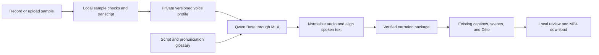

# Qwen voice cloning implementation plan

Date: 2026-10-17. Repository baseline: `cf85635` on `main`.

Status: local implementation delivered on October 17, 2026, with pinned runtime,
private profiles, studio enrollment, per-speaker production and cloud exclusion.
See [the usage guide](QWEN_VOICES.md) and delivery evidence below. Synthetic
integration fixtures verify mechanics; personal speaker similarity and listening
approval remain open until the intended speaker enrolls and reviews a recording.

## 1. Outcome and initial scope

Add **My voice** alongside **Stock voice** in the Voice & portrait step. A speaker can record or upload a sample, confirm its transcript, audition new text, save a reusable voice profile, and produce SAP tutorial/news shorts with that profile. The resulting narration drives the existing captions, scene timing, and Ditto portrait renderer.

Deliver local English narration on Apple Silicon first, including a solo narrator and, in a following milestone, two-person presentations using a cloned voice and a stock voice or two distinct cloned profiles. Keep Heart as the default for unassigned stock narration and retain existing per-speaker choices.

The first release uses local inference and local profile storage. Existing stock-voice Firebase workflows continue to work. Cloned-voice remote jobs, automatic cloud synchronization, and hosted profile enrollment are excluded from this first release. Explicit local downloads of finished videos remain supported.

## 2. Model and runtime decisions

| Decision | Planned implementation | Reason / evidence |
| --- | --- | --- |
| Primary model | `mlx-community/Qwen3-TTS-12Hz-1.7B-Base-bf16` | Base supports reference-audio cloning. Start with the unquantized MLX conversion to establish a quality baseline. [MLX model card](https://huggingface.co/mlx-community/Qwen3-TTS-12Hz-1.7B-Base-bf16). |
| Mac inference | MLX Audio in an isolated Python 3.12 environment managed with the existing `uv` workflow | MLX Audio documents the Base model with `ref_audio` and exact `ref_text`. Its environment is separate from Kokoro and Ditto. [Cloning API](https://github.com/Blaizzy/mlx-audio/blob/main/mlx_audio/tts/models/qwen3_tts/README.md). |
| Smaller alternative | Evaluate 0.6B Base only if the measured 1.7B memory/latency makes interactive use impractical | A deliberate model choice with its own runtime identity; never silently substitute it. |
| Reference transcript | Required and user-confirmed | Avoid relying on a speaker embedding alone. Qwen documents that omitting the transcript through embedding-only cloning can reduce quality. [Qwen repository](https://github.com/QwenLM/Qwen3-TTS). |
| Caption alignment | Evaluate local Qwen3-ForcedAligner through MLX Audio | Qwen TTS audio is not a replacement for Kokoro's existing timing output. The aligner maps known spoken text to measured audio. [Alignment API](https://github.com/Blaizzy/mlx-audio/blob/main/mlx_audio/stt/models/qwen3_asr/README.md). |
| Transcript assistance | Optional local Qwen3-ASR; manual correction remains available | Recording a supplied script avoids an extra download for initial enrollment. Imported free speech can use local transcription after that path is validated. |
| Delivery controls | Reference performance, script punctuation, and tested segmentation | The Base cloning interface does not promise CustomVoice's stock-speaker emotion instructions. Do not expose unsupported emotion or laughter controls. |

The model card currently lists roughly 4.54 GB of model files; this is not the total installation or peak memory requirement. Setup must calculate actual required download/storage for the selected pinned files, dependencies, and optional alignment/transcription models. Record measured peak memory on the target Mac. Hardware support and minimum macOS must be checked against the selected MLX wheel before installation; do not infer that every Mac is supported. [MLX installation](https://ml-explore.github.io/mlx/build/html/install.html).

Pin the tested MLX Audio version or commit, Python dependencies, model/tokenizer/aligner revisions, required files, and SHA-256 checksums. Preserve upstream licenses/notices. Qwen's selected model is Apache-2.0; MLX Audio is MIT. Install only required components, not its generic web server or all optional models. [MLX Audio dependencies](https://github.com/Blaizzy/mlx-audio/blob/main/pyproject.toml).

## 3. User journey

1. In **Voice & portrait**, select a speaker and choose **My voice**.
2. Show whether local voice cloning is ready, needs setup, or is unavailable on this computer. A missing runtime offers the documented setup action before any production starts.
3. Choose **Record sample** or **Upload recording**. For recording, provide a short conversational script and a microphone meter; handle denied microphone access with the upload option.
4. Let the user preview and trim a clean excerpt. Initial product target: 10–15 seconds of one speaker, selected from a recording up to two minutes. These are product defaults to validate, not vendor minimums. Reject empty/corrupt/no-speech inputs; show actionable warnings for clipping or excessive silence. Avoid claiming automatic checks prove speaker identity or eliminate all background noise.
5. Show the exact transcript of the selected excerpt. A supplied reading script is editable; if the reader departs from it, correct the text. Optional local ASR proposes a transcript for uploaded free speech, followed by user correction.
6. Confirm that this is the user's voice or a speaker who agreed to its use. Name the profile, for example **My conversational voice**. Store this enrollment record locally.
7. Generate a short audition containing SAP terms. Show the reference and generated audio side by side. A profile becomes selectable after the user accepts the audition; replacing its sample or transcript creates a new revision requiring another audition.
8. Save the selected profile with the episode revision, then produce normally. Display real stage progress: preparing voice, generating speech, aligning captions, rendering portrait/video.

Saving a draft never starts generation. Refreshing the page must retain saved profiles, selections, and recoverable job status. Browser recovery storage holds opaque profile references and editing state, not reference-audio blobs or derived speaker embeddings.

## 4. Architecture and data contracts



### Profile storage

Use `.state/voice-profiles/` for private recordings, transcripts, consent metadata, derived prompts/embeddings, and enrollment auditions. Use `.state/qwen-voice/` for the isolated runtime, pinned models, setup logs, and temporary inference data. Both paths are ignored by Git and are outside served library roots.

A profile has a random ID, local display name, language, and immutable acoustic revisions. A revision binds the normalized sample digest, confirmed transcript digest, trim interval, and preprocessing version. Consent and audition acceptance are separate local records bound to that revision and the accepted audition digest; accepting an audition does not change the acoustic revision. Names are labels, not identity. Re-enrollment creates a new revision; it never silently changes the voice used by an existing episode. Derived prompt caches are bound to both revision and runtime.

Read samples through narrow local endpoints with path containment, size/duration limits, decoded-format checks, same-origin protections, and a local session capability for private voice operations. A server listening on the LAN must not expose enrollment or cloning to arbitrary LAN clients. Browser requests and cloud jobs cannot supply arbitrary filesystem paths or model URLs.

Deleting a profile removes its source recording, transcript, derived prompts, and enrollment auditions after active use ends. Existing finished videos remain playable. Explain that deleting a profile does not erase already exported audio/video; regeneration requires that exact profile revision. Do not retain hidden sample copies in job packages or logs.

### Speaker selection and compatibility

Keep existing stock strings such as `"af_heart"` readable with their existing meaning. Add an explicit structured voice reference for Qwen, conceptually:

```json
{
  "engine": "qwen",
  "profileId": "opaque-local-id",
  "revision": "immutable-revision-digest"
}
```

Introduce versioned schemas/readers for definitions and narration records that carry new fields. Legacy version-1 definitions and verified media remain readable without a bulk rewrite. Verify saved version-1 request bytes and their original hashes before any normalization; leave those persisted requests untouched. Canonical engine references for legacy stock strings exist only in memory for dispatch. A cloned voice must never be represented by a Kokoro voice ID, a local path, or an upload URL. Missing profiles produce **Voice unavailable on this Mac**, with a relink/explicit replacement action; they never fall back to Heart.

Add a new local narration orchestrator for requests containing structured voice references. It resolves and snapshots each speaker's engine/profile/runtime before work starts and dispatches whole speaker turns through engine adapters. Keep the legacy stock-only route operational. Mixed dialogue uses the existing Kokoro adapter for stock speakers and Qwen for cloned speakers, with explicit per-engine settings rather than inheriting Kokoro speed values. The Base adapter passes reference audio and the literal confirmed transcript; it must not also pass a stock `voice` name, which the MLX cloning API documents as conflicting configuration. Compare speaker identities canonically; a renamed profile or another revision of the same profile does not by itself establish a second distinct speaker.

### Audio, captions, and portrait compatibility

Generate a complete short scene or complete dialogue turn to preserve prosody. Measure scene versus larger-context generation in the initial spike before freezing segmentation. Do not synthesize every caption-sized fragment independently just to obtain timestamps.

Keep the model's native-rate intermediate audio privately for diagnosis, then normalize into the existing mono 22,050 Hz, 16-bit PCM narration contract. Derive duration and offsets from final sample counts. Apply trimming, silence policy, and any timing-affecting processing before final alignment; avoid processing that changes duration afterward. If the pinned aligner requires a different input rate, create a separately resampled copy at that rate. Preserve the final WAV's timebase when mapping timestamps back; never relabel 22,050 Hz samples as another rate, and account for rounding at scene/turn boundaries.

Align the actual pronunciation-expanded text, then map its word spans back to display phrases: captions keep `API`, while the spoken input can use the glossary's `A P I`. Preserve existing phrase grouping, exact text coverage, speaker attribution, and seven-scene ordering. Store the alignment method and model identity honestly; do not label Qwen timings as Kokoro estimates. Empty, incomplete, non-monotonic, or out-of-range alignments block packaging with a useful error. Forced alignment alone does not prove that the model spoke every word correctly; add transcript comparison and listening checks.

Produce the normal `narration.wav`, `timing.json`, and `captions.vtt` package. The existing video renderer and Ditto use this measured narration; no replacement portrait engine is planned. A changed narration digest must invalidate the portrait/video cache. Run Qwen, alignment/transcription, Kokoro, and Ditto sequentially under a shared cross-process local model lock so CLI, auditions, and Firebase worker activity cannot unexpectedly overlap heavy inference.

### Runtime, jobs, and cache identity

Use an isolated child process with structured progress, bounded generation length, cancellation, diagnostic logs, and confirmed process termination before releasing the model lock. Start with correctness and recovery; only introduce a warm resident model if measured load time warrants its lifecycle complexity. Derive operation timeouts from measurements rather than copying Kokoro's current 60-second scene limit.

Cache identity includes the requested engine/model and exact runtime, runner code, profile revision, normalized reference digest, confirmed transcript digest, language, pronunciation glossary, script/turn text, segmentation, sampling parameters/seed, normalization, and alignment settings. Keep private provenance in local job state; export only safe engine labels and output receipts. Seed recording improves traceability but is not a promise of byte-identical generation across versions or hardware. Pin completed output bytes by digest.

Validate runtime, profile revision, FFmpeg, aligner, and requested portrait runtime at PREFLIGHT. Model downloads are setup operations; rendering must fail with setup guidance if assets are missing, rather than fetching unexpectedly. Resume only verified completed turns/scenes for the identical request. Reject partial/corrupt output and retain useful diagnostics. Repeated clicks should attach to an existing identical active audition/job or report busy.

## 5. Local and Firebase boundaries

The repository currently copies entire presentation definitions during cloud sync and recursively copies a built library into the Firebase export. Its Storage rules expose stock auditions and media publicly. Private voice data cannot simply be added to these paths.

For the first release:

- Keep raw samples, transcripts, consent records, embeddings, and prompt caches out of presentation JSON, HTML, static API snapshots, receipts, downloadable episode/library packages, and cloud logs.
- Mark cloned-voice definitions and their generated previews/media as local-only. Cloud sync, Firebase export, and worker upload paths must exclude them with a clear summary, including workflow records, report/progress snapshots, and copies embedded in a library. This includes synthesized auditions, not just the reference sample.
- Before Firebase export copies any files, classify the saved library from verified receipt/output ancestry. Reject a library containing local-only or unclassifiable media and offer a separate stock-only rebuild/export. Do not copy first and delete private paths afterward. A selector currently set to Heart does not make older cloned output for that selector public; classification follows the actual saved output. The stock-only rebuild must have a complete, consistent allowlisted asset inventory.
- Reject cloud-origin clone production and audition requests even when the named profile exists on the Mac. Resolve the actual local selector/definition before enforcing the restriction: a remote job could name an existing local clone variant without supplying any structured voice reference itself. Recheck the resolved output provenance before any cached or newly rendered media upload. An opaque ID or a matching cached result is not authorization to use a private voice.
- Maintain ordinary stock-voice cloud behavior. Hosted UI shows that My voice requires the local studio; it does not offer a broken upload control.
- Local explicit MP4/episode downloads include final narration/captions and safe receipts, never enrollment data. Private profile transfer to another Mac uses a separate explicit export/import flow, not Git or generic Firebase synchronization. Transfer is a later milestone; initial documentation explains that a fresh checkout needs local enrollment.

Remote cloning is a separate release requiring authenticated owners, authorized worker routing, private storage rules, explicit transfer/sharing, and deletion semantics. It is not a prerequisite for local cloning and is not deployed by this plan.

## 6. Implementation milestones and acceptance gates

| Milestone | Work and reviewable deliverable | Exit criteria |
| --- | --- | --- |
| M0 — Local feasibility | Pin an isolated 1.7B Base runtime; test an audition, the CAP script, reference transcript conditioning, and candidate aligner. Save a benchmark receipt and playable comparison. | Record cold/warm runtime, peak memory, installation size, output duration, pronunciation errors, and failure modes. Prove generation after setup with networking disabled. Use a project-controlled synthetic fixture for mechanics if no human sample is available; do not call it a speaker-similarity test. |
| M1 — Runtime and private profiles | Implement setup/status, sample normalization, immutable profile revisions, consent/acceptance state, containment, deletion, and local-only export policy. | Missing/corrupt models and samples fail clearly. Profiles persist across restart. No private enrollment material appears in Git, studio artifacts, ZIPs, Firebase export, or logs. Existing Kokoro setup still works. |
| M2 — Solo production | Implement Qwen narration adapter/orchestrator, versioned records, alignment, pronunciation mapping, cache fingerprints, locking, cancellation, and preflight. Render a new CAP-01 variant. | Full narration and caption validation passes, technical terms are correct, old media still opens, changed profile/text/runtime invalidates reuse, interruption resumes safely, and a full MP4 has synchronized audio/captions/portrait. |
| M3 — Studio enrollment | Add record/upload/trim/transcript/name/audition/save flow and per-speaker selection, with local readiness and useful errors. | Complete the flow through the browser at desktop/mobile widths; reload recovers saved state. Save draft does not synthesize. Missing profile, denied microphone, busy worker, failed audition, deletion, and replacement are understandable. |
| M4 — Dialogue and regression | Exercise clone+Kokoro and two distinct cloned profiles; finish model-free contract tests and local integration checks. | Speaker order, identity, pauses, captions, and portrait assignments remain correct. No caption/generation text changes the verified SAP script. Existing tutorial/news/presentation and stock-only cloud tests pass. |
| M5 — Delivery and portability | Add setup/use/troubleshooting/other-Mac docs, record measured limits, rebuild local studio, and commit/push the tested feature in complete increments. | `npm run check` and `npm run build` pass; fresh runtime setup is verified on Apple Silicon; a human reviews the full short. Publish runnable preview links and exact tested revisions. No sample, profile, model weight, or personal draft is staged. |

Implementation order: **M0 → M1 → M2 → M3 → M4 → M5**. M0 is the decision gate before building the full UI. The comparison determines whether to retain 1.7B, evaluate 0.6B, adjust reference/segmentation, or report a local-model quality limitation. Do not switch to a paid/cloud engine automatically.

## 7. Quality and test strategy

Use the same reference, CAP narration, glossary, and loudness target for comparisons. Record three candidate generations to reveal intermittent repetition or identity drift; select a result only after logging failed attempts. Test ordinary prose, questions, numerical expressions, code commands, and SAP acronyms. Have the speaker assess resemblance and naturalness separately on a 1–5 scale; proposed release target is at least 4/5 for both on an accepted short.

Hard checks: no missing/repeated sentences in accepted output; all tested SAP terms correct; no clipping; complete ordered scene/turn coverage; valid captions; final media decodes; existing duration/hook checks still apply. If the narration exceeds the desired short length, revise pacing/script explicitly and regenerate instead of silently cutting words. For manually sampled caption boundaries, use an initial target of within 200 ms of speech onset/end, with no drift at the last scene; refine only from measured evidence.

Model-free automated coverage should test corrupted uploads, unsupported profiles, unsafe paths/symlinks, transcript revisions, profile deletion, deterministic request identity, engine-specific settings, stale cache rejection, resampling/sample-count timing, glossary-to-caption mapping, dialogue attribution, failed alignment, timeout/abort child cleanup, cross-process locking, legacy fixtures, and private-data exclusion from every export/sync path. Explicitly test a cloud selector-only request naming a private local variant: it must cause zero profile reads, inference calls, or uploads. Test a saved mixed library whose current selector definition was changed to Heart: export must still copy zero cloned-voice bytes. Use a small controlled fixture and fake runner, not multi-gigabyte downloads, in normal CI.

Opt-in Mac integration covers the actual pinned models, offline generation, interruption/retry, sequential inference, the entire CAP short, and Ditto rendering. Browser QA covers microphone permission and upload fallback, trim/transcript confirmation, first audition, saved selection, missing profile on another Mac, and complete production/review. Tests must distinguish technical completion from listening quality; Gemini review can supplement human listening but does not replace the speaker's similarity judgment.

## 8. Main repository touchpoints

| Area | Existing files to extend / proposed additions |
| --- | --- |
| Setup/runtime | `src/cli.ts`, `src/mac-setup.ts`, `src/doctor.ts`; add `src/media/qwen.ts`, `qwen-runner.py`, pinned `config/qwen-voice.json` and requirements. |
| Profile management | Add `src/media/voice-profiles.ts`, profile schema, import/normalization and local API helpers. |
| Selection/contracts | `src/domain.ts`, `src/presentation.ts`, `src/contracts.ts`, `src/script-import.ts`, `src/media/voice-selection.ts`, episode/news schemas. |
| Production orchestration | `src/production.ts`, `src/media/model.ts`, `providers.ts`, `worker.ts`, `store.ts`; add shared model locking and per-engine turn handling. |
| Timing/provenance | `src/media/audio.ts`, `package.ts`, `fingerprint.ts`, `reuse.ts`, `reused-audio.ts`, `status.ts`, `src/provenance.ts`, narration timing schema, video/portrait cache consumers. |
| Studio | `src/api.ts`, `src/script-editor.ts`, `templates/script-editor.js`, `templates/script-editor.css`, `src/media/voice-audition.ts`, `src/library.ts`. |
| Export boundaries | `src/firebase/worker.ts`, `client-bridge.ts`, `export-studio.ts`, `src/library-package.ts`, `src/episode-package.ts`, library/review snapshots. No private-cloud rules expansion in the first release. |
| Regression/docs | Existing voice, media, API, editor, production, provenance, package, Firebase and video tests; `docs/VOICE_OPTIONS.md`, `docs/NEW_MAC_SETUP.md`, `docs/CREATOR_STUDIO.md`, `docs/FIREBASE_HYBRID_STUDIO.md`. |

Implemented CLI surface: `voice-clone-setup`, `voice-clone-status`,
`voice-profile-add`, `voice-profile-list`, `voice-profile-audition`,
`voice-profile-accept` and `voice-profile-delete`. Production continues through
`produce SELECTOR` after selecting a profile. Setup and enrollment remain separate.

## 9. Input needed for the first personal audition

One clean recording of the intended speaker, ideally around a minute, with no music or overlapping speech. Select a 10–15-second conversational excerpt and confirm its transcript. A supplied reading script can avoid transcription work. Prefer the delivery style wanted in the final video; voice resemblance alone does not guarantee expressive narration.

The runtime and automated integration work can proceed using controlled fixtures. Personal voice quality cannot be signed off until the intended speaker's recording and listening feedback are available.

## 10. Planning review

The independent Astra reviewer examined the repository and this plan. Its required changes are incorporated: validate original legacy request hashes before in-memory normalization; resample explicitly for the aligner's own input rate while retaining final-audio timing; check resolved selectors and actual output provenance for cloud requests; and classify exported libraries before copying any files, including workflow/report snapshots and historical cloned outputs.

The initial review covered architecture. A subsequent independent Astra code
review found eight implementation issues around frozen cloud inputs, process
locking, portable package compatibility, recovered selections, generator identity,
partial scene recovery, stale auditions and microphone cleanup. All eight were
fixed; the follow-up source review found no remaining actionable blocker in that
scope. It did not substitute for the integration and browser checks below.

## 11. Implementation and delivery evidence (October 17)

The local feature implements M0–M5's technical scope. Personal listening approval
remains outstanding. Optional ASR assistance, private profile transfer, non-Mac
runtimes, remote cloning and unsupported emotion controls remain deferred.

- **Runtime:** isolated Python 3.12.13, MLX Audio 0.5.9 / MLX 0.32.4, pinned
  1.7B Base bf16 and 0.6B 8-bit aligner. All required files were downloaded and
  checksum-verified on Apple Silicon. Network-blocked inference succeeded.
  A cold audition took 23.8 seconds and peaked at 9.0 GiB; a warm single-pass
  111-word script took 23.0 seconds and peaked at 11.4 GiB. These are one-Mac
  measurements, not minimum hardware guarantees.
- **Solo:** the real seven-scene CAP production completed `READY`, using Qwen
  narration and the existing realistic Ditto photo renderer. Measured duration
  was 51.540 seconds, hook 2.4 seconds, 1080 × 1920 H.264 at 30 fps, AAC stereo
  48 kHz. Complete decoding and audio checks passed: −16.22 LUFS integrated,
  −4.44 dB true peak. After the final lifecycle fixes, narration was regenerated
  with the new generator identity and the identical audio reused its verified
  portrait frames.
- **Dialogue:** actual Qwen + Michael narration completed `SUCCEEDED` at
  54.990 seconds; two independent Qwen profile references completed at
  45.460 seconds. Both packages verified seven scenes, twenty cues, ordered
  speaker attribution and output digests. Both Qwen profiles used controlled
  synthetic reference audio; this does not assess distinct human resemblance.
- **Studio:** browser QA exercised upload, exact transcript, consent, enrollment,
  audition playback, acceptance, speaker assignment, save without rendering,
  and same-tab recovery after reload. A 390-pixel iframe exercised the actual
  responsive editor layout and showed usable wrapping controls. Permission/setup
  failures and stale audition responses are covered by the browser-JavaScript
  harness; a live microphone permission grant was not automated.
- **Boundaries:** a real local-only library packaged into a verified ZIP with no
  profile storage or enrollment records. Cloud classification rejected that
  library; a separately rebuilt stock-only library passed classification and
  local Firebase export. Nothing was deployed, uploaded to Firebase or published.
- **Reliability:** model-free regressions cover v1 compatibility, v2 tutorial/news
  contracts, canonical speaker identity, frozen cloud input, changed/corrupt scene
  recovery, pronunciation mapping, invalid word timing, private local sessions,
  profile revisions/deletion, killed process lock recovery, recovered voice
  selections, stale auditions and microphone cleanup. Setup/audition mutations
  hold the shared lock through publication; audition audio is atomically renamed.
- **Repository checks:** a separate source-only verification copy passed
  `npm ci`, `npm run check` (219 tests, lint, type checking, five live CAP
  assertions and content validation), `npm run build` and the pilot under
  Node 22.13.0. This copy contains the changed tracked files and new feature files,
  excluding personal untracked drafts, portraits and model state. An existing
  untracked portrait draft has formatting differences; it was preserved rather
  than reformatted as part of this change.

Private integration receipts, models, samples, generated scripts and media remain
under ignored local state/artifacts or unstaged test variants. No human recording
was supplied, and no personal voice quality score is claimed. The intended speaker
should enroll a clean reference and review the audition and full video next.
